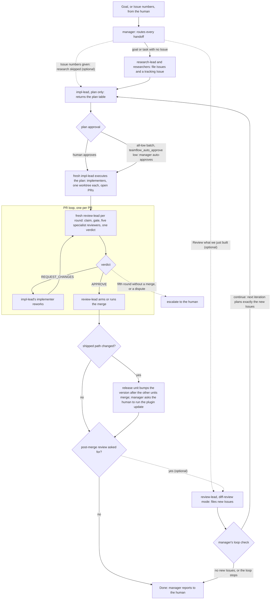

# teamflow

A Claude Code plugin that runs a three-team agent pipeline in any repository:
research turns goals into Issues, implementation works them in isolated
worktrees, and review takes part in every PR before it merges, under a
manager that routes each handoff. Every PR is reviewed by the review team: a
fresh review-lead runs five fresh specialist reviewers, records the one
verdict, and is the only actor that arms or runs a merge. A post-merge
review that files follow-up Issues is optional and runs only when you ask
for it.

## Install

```
/plugin marketplace add Ribhu-Labs/teamflow
/plugin install teamflow@teamflow
```

Launch `claude` and ask it to setup the teamflow plugin.

## How it works



The diagram is drawn from `skills/workflow/SKILL.md` and `agents/manager.md`;
where the two differ, the workflow rules win. How to run it is in
[docs/running.md](docs/running.md), which also records that per-PR review and
the optional loop were read in the rules, not run live.

## License

Copyright 2026 Ashish Kansara. Licensed under the Apache License, Version 2.0; see [LICENSE](LICENSE).
