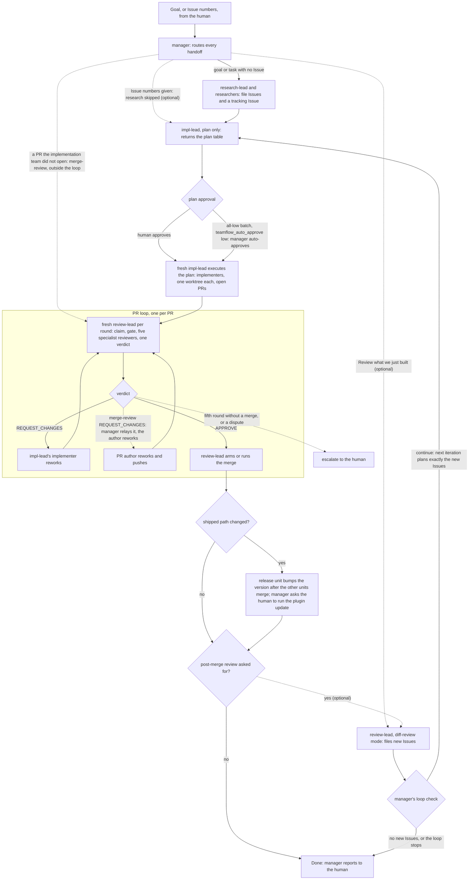

# Run

One session, started from the repository root:

```bash
claude --agent teamflow:manager     # then state your goal
```

The manager spawns research-lead, impl-lead and review-lead as subagents, and
research-lead and impl-lead spawn their workers; review-lead spawns the five
specialists. Every handoff runs through the manager, including each PR's
review rounds: impl-lead opens a PR and returns, the manager spawns a fresh
review-lead for it, and the manager resumes impl-lead with the verdict.
A PR is reviewed and merged before the batch is reported; a
post-merge review (the manager's route "Review what we just built") runs only
if you ask. A lead can still be started alone, for example
`claude --agent teamflow:impl-lead`, and then reports to you in that session;
a lone impl-lead has no manager to hand its PRs to, so it reports them open
and unreviewed. Per-PR review and the optional loop are read in
`skills/workflow/SKILL.md` and `agents/`, not run live (see **What was run**).
The workflow rules live in the `teamflow:workflow` skill. Subagents preload
it; the manager and the leads load it as their first step.



The diagram is drawn from `skills/workflow/SKILL.md` and `agents/manager.md`;
where the two differ, the workflow rules win. Per-PR review and the optional
loop are read in those rules, not run live (see **What was run**, below).

**What was run.** On 2026-11-03, Claude Code 2.1.308, `claude -p` from a
checkout of this branch (details under Headless). Observed: the plugin loads
from the checkout; with `CLAUDE_CODE_MAX_SUBAGENT_SPAWN_DEPTH=1` the manager
stops at startup, names the variable and spawns nothing; the spawn hook
allows manager to impl-lead and impl-lead to implementer, and denies
review-lead to implementer. One interactive run, with the human at the
terminal in auto permission mode (Claude Code 2.1.308, a checkout at
a554110), went from goal to a merged PR: the manager had a plan-only
impl-lead return the plan and asked; after "yes, approved" it spawned a fresh
impl-lead with the table verbatim; that lead spawned the implementer (depth
2), which opened PR #246; the lead spawned a fresh code-reviewer in an
isolated worktree (that was the pipeline before per-PR review moved to the
review team; `teamflow:code-reviewer` is now archived in
`archive/code-reviewer.md` and no longer spawned), which recorded APPROVE on head 60d47f7; #246 merged (merge
64e3f42 on `main`, local and origin), #240 closed, and the run stopped after
implementation. The lead's report reached the manager only after the
reviewer was done: it ended its turn while each worker ran and was resumed
when the worker finished. That timing comes from hook events and is observed
for one run only. **Not run:** the subagent panel, the update path,
`CLAUDE_CODE_PRINT_BG_WAIT_CEILING_MS`, a restart, a per-PR round with the
review team (review-lead and its five specialists, as merged on `main`; only
the old code-reviewer path above ran), a post-merge review and its loop, a
three-layer spawn chain (the design needs none), and a headless run to a
merged PR (see Headless). The spawn hook's table was read in
`hooks/check-spawn` for the new layout; the observed hook allows above are
from before it.

**Requirements.** The versions and defaults are from the Claude Code docs and
the research on Issue #21, not tested with teamflow, except that the depth
stop was observed.

- Claude Code 2.1.304 or later.
- Leave fork mode on: do not set `CLAUDE_CODE_FORK_SUBAGENT=0`. It is on by
  default from v2.1.302.
- Nesting needs `CLAUDE_CODE_MAX_SUBAGENT_SPAWN_DEPTH` at 2 or more: the
  manager, a lead, its worker. No handoff needs a third layer, because every
  handoff runs through the manager (`skills/workflow/SKILL.md`, Teams, *Spawn
  depth*); a three-layer chain was never run (the spike, #259, was closed as
  not needed). The variable is 3 by default from v2.1.219. The manager stops
  at startup if it reads `1` (observed under `-p`, above).

**Restart.** The manager's rules for a process start, `--resume` included
(`agents/manager.md`, Startup), in order: it first closes any still-open
tracking Issue it recorded. Then, with no stored goal, it takes your goal as
new (rule B). If its last message was a question to you, your message answers
it and it carries on (rule C, which is how `claude -p --resume <session id>
"yes"` works). If a non-auto-approved iteration has an unconfirmed release,
it asks you to confirm or skip the update (rule U). Otherwise it stops and
asks what to do, showing the goal, the iteration, the recorded PRs and
releases, `tf pr list` and the worktrees (rule D). Not run live, beyond the
headless resume described below.

**Headless (`claude -p`).** Run on 2026-11-03 with Claude Code 2.1.308,
from a checkout of this branch: `--plugin-dir` for the checkout and for
`ponytail` (`mattpocock-skills` came from its user-scope install), `PATH` with the checkout's `bin/` first, the prompt on stdin.
The plan-then-resume path ran as far as the first worker. **A headless run
from goal to merged PR is not verified.**

- Both dependencies, `ponytail` and `mattpocock-skills`, must load. In the
  live runs only `ponytail` got its own `--plugin-dir`; `mattpocock-skills`
  loaded from its user-scope install (observed). Read `plugin_errors` in the
  `init` event. With only teamflow's
  `--plugin-dir`, from another path, teamflow failed with
  `dependency-unsatisfied` (`ponytail@ponytail`) and the run still exited 0
  (seen in a clone on 2026-11-02).
- Permission prompts can't be answered, so pass `--permission-mode` or
  `--allowedTools`.
- **Workers cannot work under `-p` as observed.** Claude Code refused a Bash
  command that `cd`s into a directory and then runs git, even with
  `Bash(cd *)` and `Bash(git *)` in `--allowedTools`; it treats that as a
  safety check. The implementer's first command, `cd <worktree> && ...`, was
  refused, so nothing was implemented, reviewed or merged in that run. Only
  an interactive session can approve such a command. In the interactive
  auto-mode run above, the workers' `cd <worktree> && git ...` commands ran.
  Headless runs stop at the first worker `cd`; an interactive session gets
  past it.
- **No stored state under `-p`.** `Write` of `.manager-state.json` was
  refused as "a sensitive file", even with `Write` in `--allowedTools`, and a
  path rule (`Write(.manager-state.json)`) was refused too ("you haven't
  granted it yet"). By decision on Issue #21, a headless run keeps its state
  only within a session and its `--resume`. A fresh headless run finds
  nothing stored, so, with no stored goal (`agents/manager.md`, Startup rule
  B), it treats its prompt as a new goal. Not run live.
  Interactively, in auto mode, `Write` of `.manager-state.json` failed three
  times ("The server-side auto mode classifier gave no verdict (it skipped
  this action) ... This is a hard failure"). It succeeded only after the
  human switched the session to the default permission mode and approved the
  write prompt (the switch is in the transcript; that it was done to approve
  the write is inferred). So under auto mode, expect to switch or approve
  each time the state file is written. In that run the manager held the
  approved plan until the state file was written, its own judgement.
- A plan that needs approval ends the run at the question. Continue with
  `claude -p --resume <session id> "<answer>"`. Observed: the manager sent
  impl-lead the plan-only brief, got the table back, declined auto-approval
  for an Issue with no `severity:` label, and ended on the question. On
  `--resume "yes"` it spawned a fresh impl-lead with "Plan approved", and
  that lead spawned the implementer. A lead spawned in the background gives
  the manager a new turn when it finishes, so expect several `result` events
  in stream-json.
- Set `CLAUDE_CODE_PRINT_BG_WAIT_CEILING_MS` above your longest expected lead
  run. The documented default, `600000`, ends the idle wait and drops the
  partial result, and `0` waits indefinitely. This is from the Claude Code
  docs, not tested with teamflow.
- Leads return after their workers where the harness makes them wait:
  interactive, and `-p` or the SDK with fork mode on. Teamflow does not
  support `-p` with fork mode off. A restarted run stops and asks, except a
  fresh headless restart, which keeps no state and starts at Phase 0.

**After an update,** start a fresh `claude --agent teamflow:manager`; never
`--resume` the pre-update session. The resumed session keeps the old prompt
in its history while the new agents and `tf` load. That is from the Claude
Code docs, untested.

**Agent teams.** `CLAUDE_CODE_EXPERIMENTAL_AGENT_TEAMS` is not recommended
and is untested with teamflow. If it is on and the leads behave differently,
set it to `0`.

**Settings file.** After a `-p` run that behaves as if a setting is missing,
run `claude doctor` to see what it dropped. Under `-p`, a broken
`.claude/settings.json` gets no dialog: Claude Code skips it and continues
(settings.md:206). A managed settings document that cannot be parsed as a
JSON object instead stops Claude Code at startup, under `-p` too
(errors.md:5921, 5935). A schema problem in a parseable managed document does
not (errors.md:5937). The cites are pages of the Claude Code docs at
`https://code.claude.com/docs/en/`. `tf setup` no longer checks
`.claude/settings.json`; this line replaces that check.
